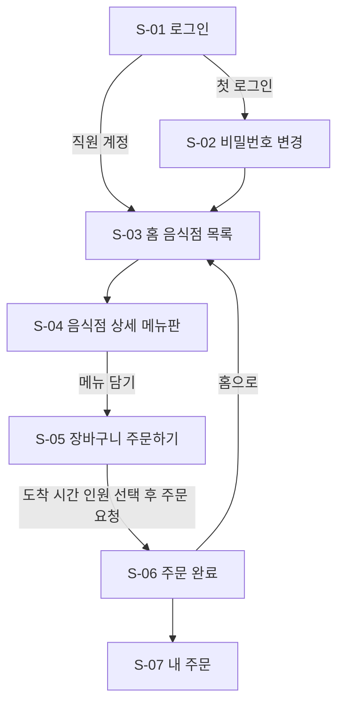
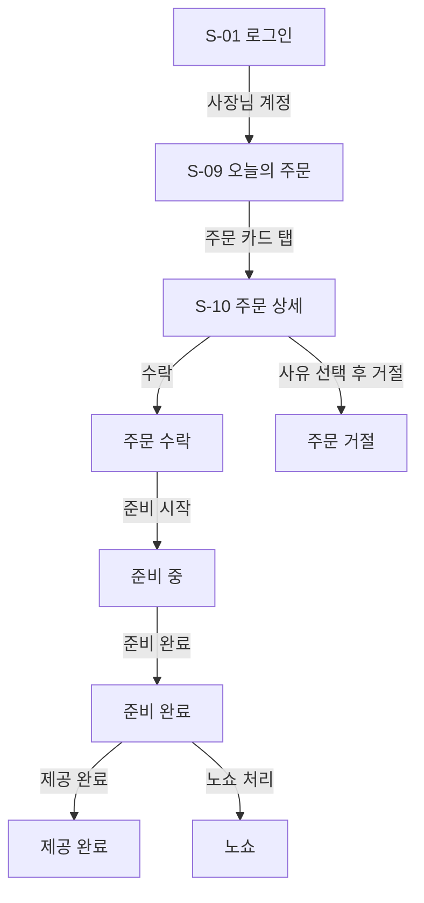
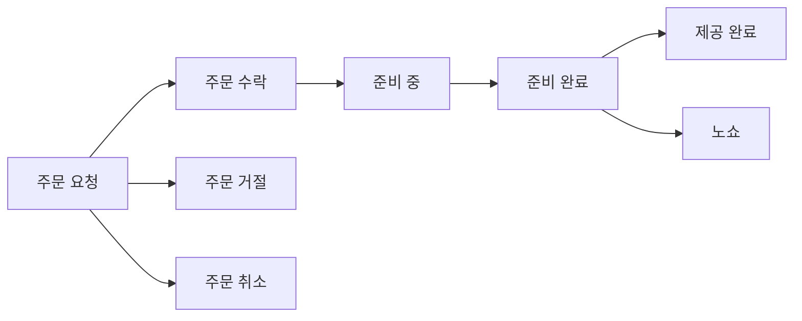
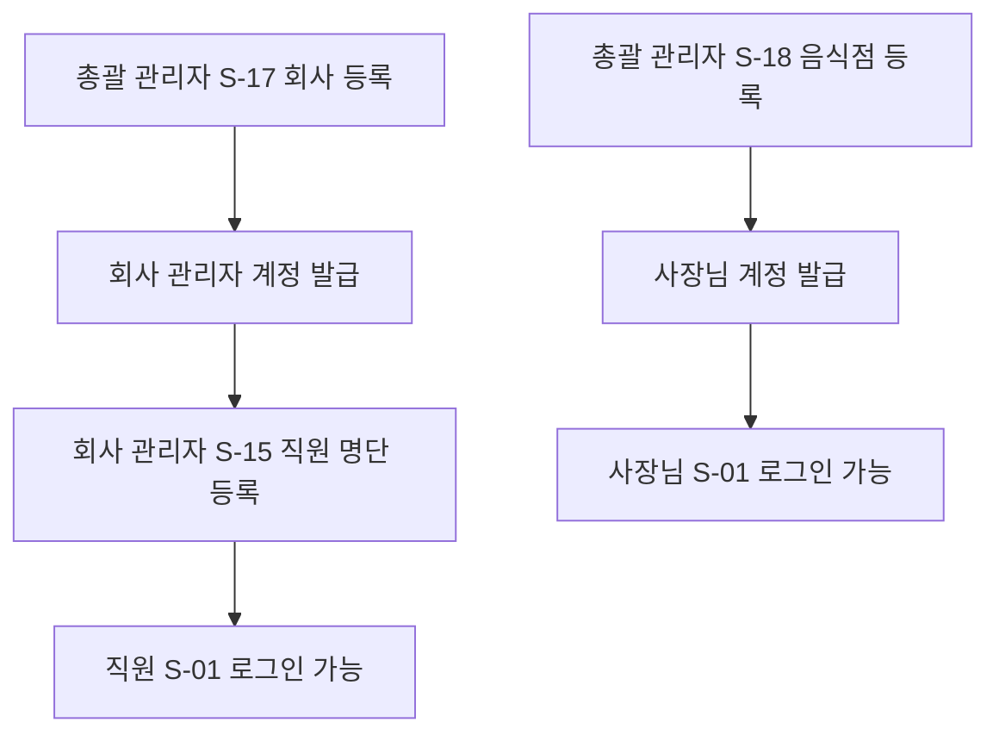

# 서비스 기획서 — 점심 미리주문

> 기준 자료: lunch-preorder-app-plan.md (v0.2)
> 구현 가능 시간: [가정] 총 2시간
> 플랫폼: iOS, Android (Expo Go로 확인)
> 이 문서는 "무엇을 만들지"만 다룹니다. 데이터 저장 방식·서버·코드는 개발 설계서에서 정합니다.

---

## 1. 서비스 개요

| 항목 | 내용 |
|---|---|
| 서비스명 (가안) | 점심 미리주문 |
| 한 줄 소개 | 같은 건물 직원들이 근처 제휴 음식점 메뉴를 미리 주문하면, 음식점은 도착 시간에 맞춰 준비하고 직원은 도착하자마자 바로 식사하는 앱 |
| 해결하려는 문제 | **직원**: 점심시간에 매장에서 주문하고 기다리는 시간이 아깝다. **음식점**: 점심 피크에 주문이 몰려 조리가 밀린다. 미리 메뉴와 인원을 알면 재료 준비·조리·자리 준비를 앞당길 수 있다. **입주 회사들**: 직원 점심시간 효율과 만족도가 올라간다. |
| 타깃 사용자 | ① 같은 건물 내 모든 입주 회사 직원 ② 근처 제휴 음식점 사장님 ③ 회사 관리자 ④ 총괄 관리자 |
| 주로 쓰는 상황 | 오전 업무 중 점심 메뉴를 정할 때 (직원) / 점심 준비 중 주문을 확인할 때 (사장님, 개인 스마트폰) |

### 확정된 운영 방식

| 항목 | 결정 |
|---|---|
| 결제 | 현장 결제 (앱에서는 결제하지 않음) |
| 식사 방식 | 매장 식사 (포장·배달 없음) |
| 음식점 사용 기기 | 사장님 개인 스마트폰 |
| 로그인 | 1차: 회사 + 사번 로그인 → 2차: 가입 후 승인 방식으로 전환 |
| 사용 범위 | 같은 건물 내 모든 입주 회사 |

---

## 2. 목표와 범위

### 2.1 이 앱으로 이루려는 것
- 직원이 매장에 도착하면 기다리지 않고 바로 식사한다.
- 사장님이 도착 시간과 인원을 미리 알고 준비한다.
- 여러 입주 회사가 앱 하나를 함께 쓴다.

### 2.2 이번 범위 (MVP = Must 기능)
- **직원**: 로그인 → 음식점·메뉴 보기 → 메뉴 담기 → 도착 시간·인원 선택 → 주문 요청 → 내 주문 상태 확인
- **사장님**: 로그인 → 오늘 주문 목록 → 주문 상세 → 수락/거절 → 준비 중 → 준비 완료 → 제공 완료/노쇼
- 회사·음식점·메뉴·계정 정보는 [가정] 미리 넣어둔 가짜 데이터로 시작한다.

### 2.3 이번에 제외하는 것
- 앱 내 결제 (현장 결제로 확정)
- 포장·배달 (매장 식사로 확정)
- 원격 푸시 알림 실제 동작 (Expo Go 제약 → 대체안 사용, 4장 참고)
- 원문 "2차 버전" 기능은 기능 목록에 Could로 올리되, 이번 수업 범위에서는 만들지 않는다.

---

## 3. 사용자 시나리오

### 시나리오 1 — 직원 김대리 (입주사 A, 30대)
1. 오전 11시, 12시 회의가 끝나면 바로 점심을 먹고 싶다.
2. 앱을 열고 회사 선택 + 사번으로 로그인한다.
3. 홈에서 "건물 앞 백반집"을 골라 김치찌개 2개를 담는다.
4. 도착 시간 12:10, 인원 2명을 고르고 "덜 맵게"라고 적은 뒤 주문을 보낸다.
5. 11시 15분에 새로고침하니 상태가 "주문 수락"으로 바뀌었다.
6. 12:10에 매장에 도착해 자리에 앉자 바로 음식이 나온다. 식사 후 카드로 결제한다.

### 시나리오 2 — 사장님 박사장 (백반집, 50대)
1. 오전 장사 준비 중 개인 폰으로 앱을 열어 "오늘의 주문"을 확인한다.
2. 신규 주문 3건이 강조되어 있다. 하나씩 눌러 수락한다. 된장찌개가 떨어진 주문은 "품절" 사유로 거절한다.
3. "시간대별 요약"을 보니 12:00~12:10에 김치찌개 5개, 6명이다. 재료를 미리 손질하고 자리를 잡아둔다.
4. 11:55에 조리를 시작하며 "준비 중", 12:08에 "준비 완료"로 바꾼다.
5. 손님이 와서 식사하면 "제공 완료"를 누른다. 끝까지 안 온 주문은 "노쇼"로 처리한다.

---

## 4. 기능 목록

우선순위: **Must**(없으면 앱이 안 돌아감) / **Should**(있어야 쓸 만함) / **Could**(여유 있으면)

### 4.1 직원 기능

| ID | 기능명 | 설명 | 우선순위 | 관련 화면 | 완료 기준 | Expo Go 제약 |
|---|---|---|---|---|---|---|
| F-01 | 로그인 (회사 선택 + 사번 + 비밀번호) / 로그아웃 | 회사를 고르고 사번·비밀번호로 로그인. 회사마다 사번이 겹칠 수 있어 "회사 + 사번"으로 사람을 구분 | Must | S-01, S-08 | 회사·사번·비밀번호를 넣으면 홈으로 이동하고, 마이페이지에서 로그아웃하면 로그인 화면으로 돌아간다 | 없음 |
| F-02 | 첫 로그인 시 비밀번호 변경 | 처음 로그인하면 비밀번호를 바꾸게 함 | Could | S-02 | 첫 로그인 직후 비밀번호 변경 화면이 뜨고, 변경 후 홈으로 이동한다 | 없음 |
| F-03 | 음식점 목록 | 이름, 위치, 영업시간, 대표 사진, 영업 중 여부 | Must | S-03 | 홈에서 제휴 음식점 카드 목록을 보고 하나를 누를 수 있다 | 없음 |
| F-04 | 음식점별 메뉴 보기 | 메뉴명, 가격, 사진, 품절 여부 | Must | S-04 | 음식점을 누르면 메뉴판이 보이고, 품절 메뉴는 담을 수 없다 | 없음 |
| F-05 | 메뉴 담기 및 수량 지정 (장바구니) | 메뉴를 담고 수량을 + / − 로 조절. [가정] 한 번에 한 음식점 메뉴만 | Must | S-04, S-05 | 메뉴를 담으면 하단에 개수·금액이 보이고, 장바구니에서 수량을 바꿀 수 있다 | 없음 |
| F-06 | 도착 예정 시간 선택 + 식사 인원 입력 | [가정] 11:30~13:00, 10분 단위 / 인원 1~10명 | Must | S-05 | 도착 시간과 인원을 고르지 않으면 주문 버튼이 눌리지 않는다 | 없음 |
| F-07 | 요청사항 입력 | 예: "덜 맵게" | Should | S-05, S-10 | 적은 요청사항이 사장님 주문 상세에 보인다 | 없음 |
| F-08 | 주문 요청 | 장바구니 내용으로 주문을 보냄. 결제는 현장 결제 안내 | Must | S-05, S-06 | 주문 요청을 누르면 주문 완료 화면이 뜨고, 사장님 오늘의 주문에 신규로 나타난다 | 없음 |
| F-09 | 주문 취소 | 사장님이 수락하기 전까지만 앱에서 취소 | Should | S-07 | "주문 요청" 상태일 때만 취소 버튼이 보이고, 누르면 "주문 취소"로 바뀐다 | 없음 |
| F-10 | 내 주문 상태 실시간 확인 | 진행 중 주문의 상태 표시. [가정] 당겨서 새로고침으로 최신 상태 확인 | Must | S-07 | 사장님이 상태를 바꾼 뒤 새로고침하면 바뀐 상태가 보인다 | 실시간 자동 반영은 개발 설계서에서 결정. 대체안: 당겨서 새로고침 |
| F-11 | 주문 수락·거절·준비 완료 알림 | 상태가 바뀌면 직원에게 알림 | Should | S-08 (알림 설정), S-07 | 앱을 닫아도 상태 변경 알림을 받는다 | **Expo Go 제약** (원격 푸시). 대체안: 화면만 구현(알림 설정 토글), 내 주문 화면에서 상태 배지로 확인 |
| F-12 | 지난 주문 내역 | 끝난 주문(제공 완료·거절·취소·노쇼) 목록 | Should | S-07 | "지난 주문" 탭에서 지난 주문을 날짜순으로 본다 | 없음 |

### 4.2 음식점(사장님) 기능

| ID | 기능명 | 설명 | 우선순위 | 관련 화면 | 완료 기준 | Expo Go 제약 |
|---|---|---|---|---|---|---|
| F-13 | 로그인 / 로그아웃 (로그인 유지) | [가정] 아이디 + 비밀번호. 한 번 로그인하면 유지 | Must | S-01, S-14 | 사장님 계정으로 로그인하면 오늘의 주문 화면으로 이동한다 | 없음 |
| F-14 | 새 주문 푸시 알림 + 알림음 | 앱을 닫아둬도 새 주문 수신 | Should | S-09 | 새 주문이 들어오면 폰에 알림과 소리가 온다 | **Expo Go 제약** (원격 푸시). 대체안: 오늘의 주문 화면의 신규 탭 개수 배지 + 신규 카드 강조 + 당겨서 새로고침 |
| F-15 | 오늘 주문 목록 (도착 시간순) | 신규 / 진행 중 / 완료 탭 | Must | S-09 | 오늘 들어온 주문이 도착 시간이 빠른 순서로 탭별로 보인다 | 없음 |
| F-16 | 주문 수락 / 거절 (사유 선택형 버튼) | 거절 사유: 품절, 만석, 시간 불가, 기타 | Must | S-10 | 수락하면 "주문 수락", 사유를 골라 거절하면 "주문 거절"로 바뀌고 직원 화면에 사유가 보인다 | 없음 |
| F-17 | 상태 변경 (준비 중 → 준비 완료 → 제공 완료 / 노쇼) | 버튼 하나로 다음 단계로 | Must | S-10 | 버튼을 누를 때마다 상태가 다음 단계로 바뀌고, 직원 내 주문에 반영된다 | 없음 |
| F-18 | 시간대별 요약 | 예: 12:00~12:10 김치찌개 5, 된장찌개 3 / 총 6명 | Should | S-11 | 10분 단위로 메뉴별 수량과 인원 합계가 보인다 | 없음 |
| F-19 | 메뉴 등록·수정·삭제 | 메뉴명, 가격, 사진, 설명 | Should | S-12, S-13 | 사장님이 메뉴를 추가·수정·삭제하면 직원 메뉴판에 반영된다 | 없음 (사진 선택·촬영은 Expo Go에서 가능) |
| F-20 | 메뉴 품절 처리 (당일 토글) | 스위치로 품절 on/off | Should | S-12, S-04 | 품절로 바꾸면 직원 메뉴판에서 "품절"로 표시되고 담을 수 없다 | 없음 |
| F-21 | 오늘 주문 받기 on/off | 휴무·재료 소진 시 주문 막기 | Could | S-14, S-03 | 끄면 직원 홈에서 해당 음식점이 "오늘 주문 마감"으로 보인다 | 없음 |
| F-22 | 가게 정보 설정 (영업시간, 주문 마감 시간) | 원문 "가게 설정" 화면 내용 | Could | S-14, S-03 | 영업시간·마감 시간을 바꾸면 직원 홈 카드에 반영된다 | 없음 |

### 4.3 관리자 기능

| ID | 기능명 | 설명 | 우선순위 | 관련 화면 | 완료 기준 | Expo Go 제약 |
|---|---|---|---|---|---|---|
| F-23 | 자기 회사 직원 명단 등록 (사번, 이름, 부서) — 엑셀 업로드 또는 직접 입력 | 회사 관리자 기능 | Could | S-15 | 직원을 추가하면 그 사번으로 로그인할 수 있다 | 엑셀 업로드는 파일 해석이 까다로움. 대체안: 직접 입력만 구현 |
| F-24 | 퇴사자 계정 비활성화 | 회사 관리자 기능 | Could | S-15 | 비활성화한 사번은 로그인할 수 없다 | 없음 |
| F-25 | 입주 회사 등록 및 회사 관리자 계정 발급 | 총괄 관리자 기능 | Could | S-17 | 등록한 회사가 로그인 화면 회사 선택 목록에 나타난다 | 없음 |
| F-26 | 음식점 등록 및 사장님 계정 발급 | 총괄 관리자 기능 | Could | S-18 | 등록한 음식점이 직원 홈에 나타나고 사장님이 로그인할 수 있다 | 없음 |
| F-27 | 전체 주문 현황 조회 (날짜·음식점·회사별) | 총괄 관리자 기능 | Could | S-19 | 조건을 고르면 해당 주문 목록과 건수가 보인다 | 없음 |

### 4.4 원문 "2차 버전" 기능 (이번 수업 범위 밖)

| ID | 기능명 | 설명 | 우선순위 | 관련 화면 | 완료 기준 | Expo Go 제약 |
|---|---|---|---|---|---|---|
| F-28 | 가입 후 승인 방식 전환 | 직원이 회사 선택 후 직접 가입 → 회사 관리자가 승인 | Could | S-16 (가입 화면은 [가정] 추후 추가) | 가입 신청 후 승인되면 로그인할 수 있다 | 없음 |
| F-29 | 음식점별 시간대 주문 한도 (좌석 수 기준) | 예: 12:00 타임 최대 20명 | Could | — (화면 미정) | 한도가 찬 시간은 선택할 수 없다 | 없음 |
| F-30 | 자주 먹는 메뉴 즐겨찾기 / 재주문 | | Could | — (화면 미정) | 지난 주문에서 한 번에 다시 담을 수 있다 | 없음 |
| F-31 | 단체 주문 (팀 단위로 한 명이 대표 주문) | | Could | — (화면 미정) | 한 명이 여러 사람 몫을 한 주문으로 넣을 수 있다 | 없음 |
| F-32 | 노쇼 누적 시 주문 제한 | | Could | — (화면 미정) | 노쇼가 기준 횟수를 넘으면 주문할 수 없다 | 없음 |
| F-33 | 메뉴 옵션 (곱빼기, 맵기 등) | | Could | — (화면 미정) | 메뉴를 담을 때 옵션을 고를 수 있다 | 없음 |
| F-34 | 공지사항 (음식점 휴무, 신메뉴) | | Could | — (화면 미정) | 공지가 직원 홈에 보인다 | 없음 |
| F-35 | 월별 통계 (음식점별 주문 수, 회사별 이용 현황) | | Could | — (화면 미정) | 월을 고르면 통계가 보인다 | 없음 |

---

## 5. 사용자 흐름

### FL-01 직원 주문 (Must)
1. S-01 로그인: 회사 선택 + 사번 + 비밀번호 (F-01)
2. (첫 로그인이면) S-02 비밀번호 변경 (F-02, Could)
3. S-03 홈: 음식점 선택 (F-03)
4. S-04 메뉴판: 메뉴 담기 (F-04, F-05)
5. S-05 장바구니: 수량 확인, 도착 시간·인원 선택, 요청사항 (F-05, F-06, F-07)
6. "주문 요청하기" → S-06 주문 완료 (F-08)
7. S-07 내 주문: 새로고침하며 상태 확인 (F-10)

### FL-02 사장님 주문 처리 (Must)
1. S-01 로그인: 아이디 + 비밀번호 (F-13)
2. S-09 오늘의 주문: 신규 탭 확인, 당겨서 새로고침 (F-15, F-14 대체안)
3. S-10 주문 상세: 수락 (F-16)
4. 조리 시작 → "준비 시작" → 준비 중 (F-17)
5. 조리 끝 → "준비 완료" (F-17)
6. 손님 식사 → "제공 완료" / 미방문 → "노쇼" (F-17)

### 주문 상태 흐름 (FL-01, FL-02 공통)

| 상태 | 바꾸는 사람 | 설명 |
|---|---|---|
| 주문 요청 | 직원 | 주문을 넣은 상태 |
| 주문 수락 | 사장님 | 확인하고 받기로 함 |
| 주문 거절 | 사장님 | 품절·만석·시간 불가·기타 (사유 표시) |
| 주문 취소 | 직원 | 수락 전까지만 앱에서 취소 |
| 준비 중 | 사장님 | 조리 시작 |
| 준비 완료 | 사장님 | 음식 준비 끝 |
| 제공 완료 | 사장님 | 손님이 와서 식사함 |
| 노쇼 | 사장님 | 도착 시간이 지나도 오지 않음 |

> [가정] 원문은 노쇼를 "주문 수락" 아래에 그렸지만, 실제로는 도착 시간이 지나야 판단할 수 있으므로 "준비 완료" 이후에 처리하도록 했습니다.

### FL-03 거절·취소 (Must 거절 / Should 취소)
1. 직원: S-07 내 주문에서 "주문 요청" 상태 주문의 "주문 취소" 누름 → 확인 모달 → 주문 취소 (F-09)
2. 사장님: S-10 주문 상세에서 "거절" → 사유 선택 바텀시트 → 주문 거절 (F-16)
3. 직원: S-07에서 거절 사유 확인 (F-10)

### FL-04 메뉴 관리 (Should)
1. S-12 메뉴 관리: 품절 스위치 on/off (F-20)
2. "+ 메뉴 추가" 또는 메뉴 탭 → S-13 메뉴 등록·수정 (F-19)
3. 저장 → S-12로 돌아감 → 직원 S-04에 반영

### FL-05 관리자 등록 (Could)
1. 총괄 관리자: S-17 회사 등록 + 회사 관리자 계정 발급 (F-25)
2. 총괄 관리자: S-18 음식점 등록 + 사장님 계정 발급 (F-26)
3. 회사 관리자: S-15 직원 명단 등록 (F-23)
4. 직원: 받은 사번으로 S-01 로그인

---

## 6. 화면 목록

| ID | 화면명 (원문 번호) | 목적 | 진입 경로 | 관련 기능 |
|---|---|---|---|---|
| S-01 | 로그인 (C-1) | 사용자 유형별 로그인, 다음 화면 분기 | 앱 실행 / 로그아웃 | F-01, F-13 |
| S-02 | 비밀번호 변경 (C-2) | 첫 로그인 시 비밀번호 변경 | S-01 (첫 로그인), S-08 | F-02 |
| S-03 | 홈 — 음식점 목록 (E-1) | 음식점 고르기 | S-01 (직원), 하단 탭 "홈" | F-03, F-21, F-22 |
| S-04 | 음식점 상세 — 메뉴판 (E-2) | 메뉴 보고 담기 | S-03 음식점 카드 | F-04, F-05, F-20 |
| S-05 | 장바구니 / 주문하기 (E-3) | 주문 내용 확정 후 요청 | S-04 하단 장바구니 바 | F-05, F-06, F-07, F-08 |
| S-06 | 주문 완료 (E-4) | 주문 접수 결과 확인 | S-05 주문 요청 성공 | F-08 |
| S-07 | 내 주문 (E-5) | 진행 중 주문 상태, 지난 주문 확인 | 하단 탭 "내 주문", S-06 | F-09, F-10, F-11, F-12 |
| S-08 | 마이페이지 (E-6) | 내 정보, 알림 설정, 로그아웃 | 하단 탭 "마이" | F-01, F-02, F-11 |
| S-09 | 오늘의 주문 (R-1) | 오늘 주문을 도착 시간순으로 확인 | S-01 (사장님), 하단 탭 "주문" | F-14, F-15 |
| S-10 | 주문 상세 (R-2) | 주문 확인, 수락·거절·상태 변경 | S-09 주문 카드 | F-07, F-16, F-17 |
| S-11 | 시간대별 요약 (R-3) | 조리·자리 준비용 수량 확인 | 하단 탭 "요약" | F-18 |
| S-12 | 메뉴 관리 (R-4) | 메뉴 목록, 품절 처리 | 하단 탭 "메뉴" | F-19, F-20 |
| S-13 | 메뉴 등록·수정 (R-5) | 메뉴 추가·수정·삭제 | S-12 "+ 메뉴 추가" / 메뉴 항목 | F-19 |
| S-14 | 가게 설정 (R-6) | 영업시간, 마감 시간, 오늘 주문 받기, 로그아웃 | 하단 탭 "설정" | F-13, F-21, F-22 |
| S-15 | 직원 명단 (M-1) | 자기 회사 직원 추가·비활성화 | S-01 (회사 관리자), 상단 탭 | F-23, F-24 |
| S-16 | 가입 승인 (M-2, 2차) | 가입 신청 승인·거절 | S-15 상단 탭 | F-28 |
| S-17 | 회사 관리 (A-1) | 입주 회사 등록, 회사 관리자 계정 발급 | S-01 (총괄 관리자), 하단 탭 | F-25 |
| S-18 | 음식점 관리 (A-2) | 음식점 등록, 사장님 계정 발급, 비활성화 | 하단 탭 | F-26 |
| S-19 | 주문 현황 (A-3) | 날짜·음식점·회사별 주문 조회 | 하단 탭 | F-27 |

---

## 7. 다루는 정보

앱이 보여주거나 저장하는 정보입니다. (데이터베이스 설계가 아닙니다.)

| 정보 | 항목 |
|---|---|
| 회사 | 회사명, 층/호수, 사용 여부 |
| 사용자 | 소속 회사, 사번(직원) 또는 아이디(사장님·관리자), 이름, 부서, 사용자 유형(직원/사장님/회사 관리자/총괄 관리자), 소속 음식점(사장님), 상태(대기/승인/비활성), 비밀번호 |
| 음식점 | 이름, 위치, 전화번호, 영업시간, 주문 마감 시간, 대표 사진, 오늘 주문 받기 여부 |
| 메뉴 | 소속 음식점, 메뉴명, 가격, 사진, 설명, 품절 여부 |
| 주문 | 주문 번호, 주문자(회사·이름), 음식점, 도착 예정 시간, 식사 인원, 상태, 거절 사유, 요청사항, 총 금액(참고용, 현장 결제), 주문 일시 |
| 주문 메뉴 | 메뉴명, 수량, 단가 |
| 장바구니 | 음식점, 담은 메뉴와 수량 (주문 요청 전까지 임시) |

> 사번은 회사마다 겹칠 수 있으므로 "소속 회사 + 사번"으로 사람을 구분합니다.

---

## 8. 구현 순서 제안

### 1단계 — Must (목표: 수업 시간 안에 완성)
1. 가짜 데이터 준비: 회사 2~3개, 음식점 2~3개, 메뉴 각 4~5개, 직원·사장님 계정 [가정]
2. S-01 로그인 (F-01, F-13) — 유형별 화면 분기
3. S-03 홈 → S-04 메뉴판 (F-03, F-04)
4. S-05 장바구니 (F-05, F-06) → S-06 주문 완료 (F-08)
5. S-09 오늘의 주문 (F-15) → S-10 주문 상세 (F-16, F-17)
6. S-07 내 주문 (F-10) — 진행 중 탭만
7. 처음부터 끝까지 시연: 직원 주문 → 사장님 수락·준비·제공 → 직원 상태 확인

### 2단계 — Should
8. F-07 요청사항, F-09 주문 취소, F-12 지난 주문
9. S-11 시간대별 요약 (F-18)
10. S-12, S-13 메뉴 관리 (F-19, F-20)
11. F-11, F-14 알림 — 화면만 구현 (대체안)

### 3단계 — Could
12. S-02 비밀번호 변경, S-14 가게 설정
13. 관리자 화면 S-15, S-17, S-18, S-19
14. 2차 기능 (F-28~F-35)

---

## 9. 추가 제안 (원문에 없는 아이디어)

1. **체험 계정 버튼**: 로그인 화면에 "직원으로 체험 / 사장님으로 체험" 버튼을 두면 수업 시연과 테스트가 빨라집니다.
2. **주문 마감 안내 배너**: 직원 홈 상단에 "주문 마감 11:30까지 20분 남았어요"를 보여주면 마감을 놓치지 않습니다.
3. **곧 도착 표시**: 사장님 오늘의 주문에서 도착 10분 전 주문에 "곧 도착" 표시를 붙이면 조리 시작 시점을 잡기 쉽습니다.

---

## 10. 확인 필요 사항

### 이번 문서 작성 중 생긴 가정
1. 구현 가능 시간 2시간이 맞나요? 시간이 더 있으면 Should까지 Must로 올릴 수 있습니다.
2. 직원이 넣은 주문이 **사장님 폰에** 보이려면 기기끼리 정보를 주고받아야 합니다. 수업에서 이 부분(서버)을 다루나요? 다루지 않는다면 한 폰에서 계정을 바꿔가며 시연하는 방식이 됩니다.
3. 주문 상태를 자동으로 바로 반영할지, 새로고침으로 확인할지 (현재: 새로고침 [가정])
4. 음식점·관리자 로그인을 아이디 + 비밀번호로 해도 되나요?
5. 장바구니에 한 번에 한 음식점 메뉴만 담는 규칙이 맞나요?
6. 주문 마감 11:30, 도착 시간 11:30~13:00 10분 단위, 인원 1~10명이 적절한가요?
7. 노쇼를 "준비 완료" 이후에 처리하는 것으로 바꿨는데 괜찮나요?

### 원문에서 넘어온 확인 사항
8. 운영 주체: 총괄 관리자는 누가 맡나요? (건물 관리사무소 / 특정 입주 회사 / 본인 팀)
9. 직원 명단 확보: 각 회사가 사번·이름 명단을 줄 수 있나요? 어렵다면 처음부터 가입 후 승인 방식이 현실적입니다.
10. 좌석 문제: 1차부터 시간대별 인원 한도가 필요할 만큼 붐비는 매장이 있나요?
11. 규모: 입주 회사 수, 예상 직원 수, 제휴 음식점 수
12. 음식점 위치: 건물 내 식당가인가요, 건물 밖 근처 음식점인가요?
13. 노쇼 대응: 1차에 기록만 할지, 바로 제한할지
